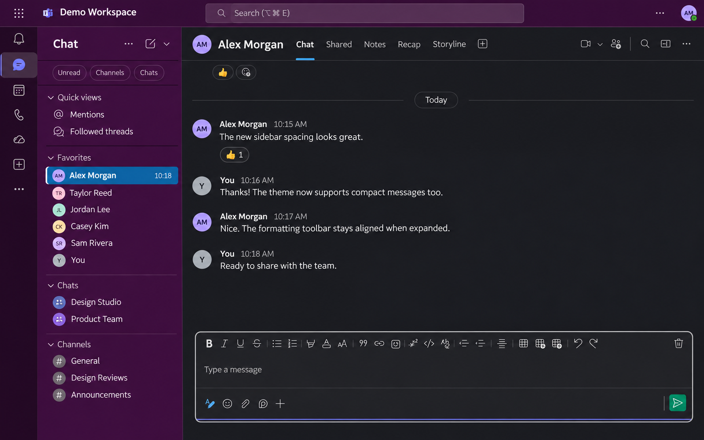

# Teams Slack UI

A Slack-inspired theme for **Microsoft Teams in your browser**, installed through
Stylus. It adds aubergine navigation, dark conversation surfaces, bundled Lato
fonts, and a shared left-aligned message timeline.

## Preview



*AI-edited preview based on a themed Teams screenshot. Names, avatars, workspace
details, and messages are fictional; the image illustrates the theme's appearance.*

**Works on:** <https://teams.cloud.microsoft/>. The native Teams desktop and
mobile apps are not supported. Development and visual checks have been performed
in Firefox; other browsers may need additional verification.

## What changes

- Compact sidebar rows, bold team names, readable unread indicators, and truncated long names.
- Aligned sent and received messages, rounded-square avatars, and native author grouping.
- Matching chat, channel, thread, and details-panel surfaces.
- A unified composer with aligned formatting, attachment, and send controls.
- Styled quotes, code blocks, mentions, reactions, and image attachments.
- Responsive composer spacing, visible keyboard focus, and system high-contrast color rules.

Both **Comfy** and **Compact** Teams message densities are supported. Lato is
included in the CSS; no font installation or external font service is needed.

## Installation

### 1. Install Stylus

Install **Stylus** using the official listing for your browser:

| Browser | Extension |
| --- | --- |
| Firefox | [Stylus on Firefox Add-ons](https://addons.mozilla.org/en-US/firefox/addon/styl-us/) |
| Chrome / Chromium browsers | [Stylus on the Chrome Web Store](https://chromewebstore.google.com/detail/stylus/clngdbkpkpeebahjckkjfobafhncgmne) |

Use the same browser for Stylus and Teams.

### 2. Install the theme

Choose the route that matches how you received the file.

**From a hosted repository:**

1. Open [teams-slack.user.css](teams-slack.user.css).
2. On GitHub, click **Raw** to open the stylesheet itself.
3. Stylus should show an installation page. Click **Install style**.

**From a downloaded or shared copy:**

1. Save `teams-slack.user.css`, keeping the complete filename.
2. In Firefox, open it with **Ctrl+O** (Windows/Linux) or **Cmd+O** (macOS).
3. In Chrome/Chromium, open Stylus → **Manage**, then drag the file onto that page.
4. Complete the Stylus installation prompt.

These routes follow the [official Stylus UserCSS installation instructions](https://github.com/openstyles/stylus/wiki/Writing-UserCSS#installation).

### 3. Open Teams

1. Visit <https://teams.cloud.microsoft/> and sign in.
2. Choose Teams’ **Dark** appearance in its settings for consistent menus and dialogs.
3. Refresh Teams. Open the Stylus extension and check that **Teams Slack UI** is enabled.

You should see purple navigation and a dark message area. Installation is local
to your browser; each person installs their own copy. A Python server is **not
needed for everyday use**.

## Optional: show your own profile picture

Compact mode can display your avatar natively. For sent messages in Comfy mode,
you can supply a picture through the style’s local preference:

1. Copy the image address of your signed-in Teams profile picture. If the browser
   offers no **Copy image address** action, inspect the avatar’s image element
   with Developer Tools and copy its `src` value.
2. Open Stylus → **Manage** → the configuration/gear icon for **Teams Slack UI**.
3. Set **Your profile picture (CSS url)** to:

   ```css
   url("YOUR_TEAMS_PROFILE_IMAGE_URL")
   ```

4. Save the preference. Use `none` to remove the custom picture.

This setting stays in Stylus; do not put personal image URLs into the shared CSS.
Teams image addresses may require your signed-in session and can change. If a
photo stops loading, copy its current address again. The author name remains
available even without a photo.

## Updating and removing

For a hosted installation, use Stylus’ update check. For a downloaded copy,
install the newer file again. Keep the style’s name and namespace unchanged so
Stylus recognizes it. Local-file imports do not provide automatic updates.
See [Stylus’ update and reinstallation guidance](https://github.com/openstyles/stylus/wiki/Writing-UserCSS#reinstallation).

Previously installed as **Teams Clean UI**? Version 0.9.3 renames the theme to
**Teams Slack UI**. If Stylus creates a second entry during installation, disable
or remove the older entry so only one copy is active.

To temporarily return to Teams’ original appearance, disable **Teams Slack UI**
in the Stylus popup. To remove it, delete the style from Stylus → **Manage**.

## Troubleshooting

| Problem | What to check |
| --- | --- |
| Nothing changes | Confirm the address is `teams.cloud.microsoft`, Stylus is enabled, and this style is switched on. Refresh Teams. |
| The CSS opens as plain text | Check that the filename ends in `.user.css`. Check Stylus’ option to open its installer for UserCSS URLs, or use the downloaded-file route above. |
| Menus look different from the chat | Use Teams’ Dark appearance and disable other Teams themes while comparing. |
| A new update does not appear | Reopen the source file and compare the version on the installer page with the file’s `@version`. |
| An element becomes misaligned | Teams can change its markup. Note the affected view, density setting, browser, and zoom level when reporting the issue. |
| Browser extensions are blocked | Ask your organization’s browser administrator whether Stylus is permitted. |

## Local development and live reload

The theme is a single UserCSS file. There is no build step, package installation,
or automated test suite.

From the folder containing `teams-slack.user.css`, run:

```sh
python3 -m http.server 8765 --bind 127.0.0.1
```

Open <http://127.0.0.1:8765/teams-slack.user.css>, install the style, and enable
**Live reload**. Keep the installer tab open and the server running while editing.
Stylus 2 or newer supports this localhost workflow. See the
[official live reload guide](https://github.com/openstyles/stylus/wiki/Writing-UserCSS#live-reload-on-the-fly-previewing).

If updates stop, check the terminal for errors and toggle Live reload off and on.
If port 8765 is occupied, use another port in both the command and URL. Stop the
server with **Ctrl+C** when finished; the installed theme remains available.

Before sharing changes, check direct chats, group chats, channels, and threads in
both densities. Toggle formatting, inspect quotes and attachments, navigate with
Tab, and test narrow layouts and browser zoom. Do not send messages just to test
styling. System high-contrast colors still need an OS-level visual check.

Selectors use Teams’ `data-tid` hooks and Fluent classes. Comfy continuation
grouping also uses the generated timestamp class `___115jusq`; a Teams update may
require revisiting that hook. Keep layout changes scoped and preserve native
message virtualization and accessible controls.

## Repository files

- [teams-slack.user.css](teams-slack.user.css) — the installable theme, including embedded fonts.
- [licenses/Lato-OFL.txt](licenses/Lato-OFL.txt) — the bundled Lato font’s SIL Open Font License.
- [AGENTS.md](AGENTS.md) — contributor instructions.

## License

The theme and documentation are available under the [MIT License](LICENSE).
Copyright © 2026 Emre Bozkurt.

The bundled Lato fonts remain under the
[SIL Open Font License 1.1](licenses/Lato-OFL.txt). Their copyright and license
notice is also embedded in the installable stylesheet so it accompanies shared
copies of that file.

This is an independent appearance customization, unaffiliated with Microsoft or Slack.
